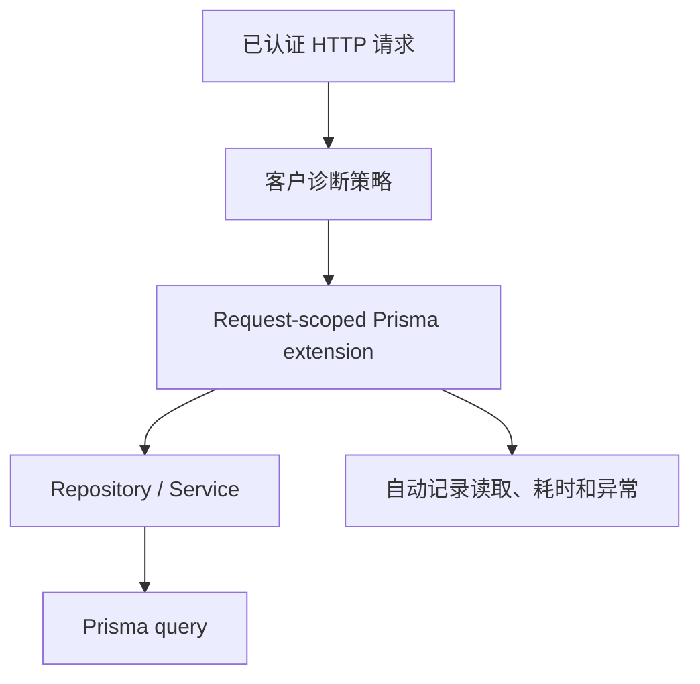

# Database 客户级诊断日志方案

可以。以 database 为例，**不要在每个 repository 的 `select/findMany` 旁边写日志**，而是在 Prisma adapter 边界统一拦截。

推荐规则：

| 场景 | 行为 |
|---|---|
| 普通客户的正常查询 | 不记录 |
| 指定客户开启诊断 | `debug` 记录每次读取操作 |
| 所有客户的慢查询 | `warn` |
| 所有客户的数据库异常 | `error` |
| 创建、支付等业务事件 | 由业务层显式产生 domain/audit event |
| 原始 SQL 和参数 | 默认禁止，临时受控诊断时才开启 |

核心调用关系：



Prisma 的 Query Extension 能拦截所有 model operation，包括 `findUnique`、`findMany`、`count` 等；extended client 是轻量对象，仍与原始 client 共享连接池，因此可以为每个请求创建 extended client，但不能为每个请求创建新的 `PrismaClient`。[Prisma Query Extensions](https://docs.prisma.io/docs/orm/prisma-client/client-extensions/query)、[Prisma Client Extensions](https://www.prisma.io/docs/orm/prisma-client/client-extensions)

## 1. 让 request logger 可以单独开启 debug

如果生产环境 root logger 是 `info`，普通 `debug` 日志会被过滤。为了只给指定客户开启 debug，可以允许 child logger 覆盖 level。

`/Users/chent/Downloads/test_demo/packages/logger/src/types.ts`

```ts
export type LogLevel =
  | 'trace'
  | 'debug'
  | 'info'
  | 'warn'
  | 'error'
  | 'fatal'

export type LoggerLevel =
  | LogLevel
  | 'silent'

export type LogFields = Readonly<
  Record<string, unknown>
>

export type LogInput =
  | string
  | LogFields

export interface ChildLoggerOptions {
  level?: LoggerLevel
}

export interface Logger {
  child(
    bindings: LogFields,
    options?: ChildLoggerOptions,
  ): Logger

  isLevelEnabled(level: LogLevel): boolean

  trace(input: LogInput, message?: string): void
  debug(input: LogInput, message?: string): void
  info(input: LogInput, message?: string): void
  warn(input: LogInput, message?: string): void
  error(input: LogInput, message?: string): void
  fatal(input: LogInput, message?: string): void
}
```

然后修改 Pino adapter 中的 `child()`。

`/Users/chent/Downloads/test_demo/packages/logger/src/pino.ts`

```ts
function adapt(nativeLogger: PinoLogger): Logger {
  return {
    child(bindings, options) {
      const childOptions = options?.level
        ? { level: options.level }
        : undefined

      return adapt(
        nativeLogger.child(
          { ...bindings },
          childOptions,
        ),
      )
    },

    isLevelEnabled(level) {
      return nativeLogger.isLevelEnabled(level)
    },

    trace(input, message) {
      write(nativeLogger, 'trace', input, message)
    },

    debug(input, message) {
      write(nativeLogger, 'debug', input, message)
    },

    info(input, message) {
      write(nativeLogger, 'info', input, message)
    },

    warn(input, message) {
      write(nativeLogger, 'warn', input, message)
    },

    error(input, message) {
      write(nativeLogger, 'error', input, message)
    },

    fatal(input, message) {
      write(nativeLogger, 'fatal', input, message)
    },
  }
}
```

这样即使全局是 `info`，指定客户对应的 request child logger 也可以输出 `debug`。

## 2. 定义数据库诊断上下文

这些类型属于 database 能力，不要放进 `@monorepo/types`。

`/Users/chent/Downloads/test_demo/packages/database/src/diagnostics/types.ts`

```ts
export interface DatabaseDiagnosticContext {
  requestId?: string
  tenantId?: string
  actorId?: string

  /**
   * 是否为当前客户记录普通读取操作。
   */
  verboseReads: boolean
}

export interface DatabaseDiagnosticOptions {
  /**
   * 超过该时间的查询，无论客户是否开启 verbose，
   * 都以 warn 级别记录。
   */
  slowQueryThresholdMs?: number
}
```

这里传入的是已经判定好的 `verboseReads`，而不是把“哪些客户算特殊客户”的业务规则塞进 database package。

## 3. 创建 Prisma 自动诊断 extension

下面假设你当前仍从 `@prisma/client` 导入 `PrismaClient`。如果 Prisma generator 输出到了自定义目录，需要调整 import 路径。

`/Users/chent/Downloads/test_demo/packages/database/src/diagnostics/with-diagnostics.ts`

```ts
import type {
  PrismaClient,
} from '@prisma/client'

import type {
  Logger,
} from '@monorepo/logger'

import type {
  DatabaseDiagnosticContext,
  DatabaseDiagnosticOptions,
} from './types.js'

const READ_OPERATIONS = new Set<string>([
  'findUnique',
  'findUniqueOrThrow',
  'findFirst',
  'findFirstOrThrow',
  'findMany',
  'count',
  'aggregate',
  'groupBy',
])

function elapsedMilliseconds(
  startedAt: number,
): number {
  return Math.round(
    (performance.now() - startedAt) * 100,
  ) / 100
}

function objectKeys(
  value: unknown,
): readonly string[] | undefined {
  if (
    typeof value !== 'object' ||
    value === null ||
    Array.isArray(value)
  ) {
    return undefined
  }

  return Object.keys(value).sort()
}

/**
 * 只记录查询结构，不记录查询值。
 *
 * 例如：
 * {
 *   whereFields: ["email", "tenantId"],
 *   selectFields: ["id", "name"]
 * }
 *
 * 不会记录具体 email、tenantId 或密码。
 */
function describeArguments(
  args: unknown,
): Record<string, unknown> | undefined {
  if (
    typeof args !== 'object' ||
    args === null ||
    Array.isArray(args)
  ) {
    return undefined
  }

  const record =
    args as Record<string, unknown>

  const description: Record<string, unknown> = {}

  const argumentFields = objectKeys(record)

  if (argumentFields?.length) {
    description.argumentFields = argumentFields
  }

  const whereFields = objectKeys(record.where)

  if (whereFields?.length) {
    description.whereFields = whereFields
  }

  const selectFields = objectKeys(record.select)

  if (selectFields?.length) {
    description.selectFields = selectFields
  }

  const includeFields = objectKeys(record.include)

  if (includeFields?.length) {
    description.includeFields = includeFields
  }

  const orderByFields = objectKeys(record.orderBy)

  if (orderByFields?.length) {
    description.orderByFields = orderByFields
  }

  return Object.keys(description).length > 0
    ? description
    : undefined
}

function getResultCount(
  result: unknown,
): number | undefined {
  if (Array.isArray(result)) {
    return result.length
  }

  return undefined
}

export function withDatabaseDiagnostics(
  client: PrismaClient,
  parentLogger: Logger,
  context: DatabaseDiagnosticContext,
  options: DatabaseDiagnosticOptions = {},
) {
  const slowQueryThresholdMs =
    options.slowQueryThresholdMs ?? 500

  const logger = parentLogger.child(
    {
      component: 'database',
      tenantId: context.tenantId,
      actorId: context.actorId,
    },
    context.verboseReads
      ? { level: 'debug' }
      : undefined,
  )

  return client.$extends({
    name: 'database-diagnostics',

    query: {
      $allModels: {
        async $allOperations({
          model,
          operation,
          args,
          query,
        }) {
          const startedAt = performance.now()

          try {
            const result = await query(args)

            const durationMs =
              elapsedMilliseconds(startedAt)

            const fields = {
              event: 'database.query.completed',
              model,
              operation,
              durationMs,
              resultCount: getResultCount(result),
              queryShape: describeArguments(args),
            }

            if (
              durationMs >= slowQueryThresholdMs
            ) {
              logger.warn(
                fields,
                'slow database operation',
              )
            } else if (
              context.verboseReads &&
              READ_OPERATIONS.has(operation)
            ) {
              logger.debug(
                fields,
                'database read completed',
              )
            }

            return result
          } catch (error: unknown) {
            logger.error(
              {
                event: 'database.query.failed',
                model,
                operation,
                durationMs:
                  elapsedMilliseconds(startedAt),
                queryShape:
                  describeArguments(args),
                err: error,
              },
              'database operation failed',
            )

            throw error
          }
        },
      },
    },
  })
}

export type DiagnosticDatabaseClient =
  ReturnType<typeof withDatabaseDiagnostics>
```

这里没有记录：

- `where` 的实际值
- `data` 的内容
- SQL 参数
- 查询结果内容

即便针对特殊客户开了 debug，默认也只看到：

```json
{
  "event": "database.query.completed",
  "tenantId": "tenant-123",
  "model": "User",
  "operation": "findMany",
  "durationMs": 18.42,
  "resultCount": 3,
  "queryShape": {
    "argumentFields": [
      "select",
      "where"
    ],
    "whereFields": [
      "status",
      "tenantId"
    ],
    "selectFields": [
      "id",
      "name"
    ]
  }
}
```

这通常已经能判断：

- 调用了哪个 model
- 使用了哪种读取操作
- 查询结构是否符合预期
- 是否出现 N+1
- 查询是否过慢
- 返回记录数量是否异常

## 4. Database package 只创建一个基础 client

`/Users/chent/Downloads/test_demo/packages/database/src/client.ts`

这里需要沿用你实际的 libSQL adapter 初始化代码。结构应该类似：

```ts
import {
  PrismaClient,
} from '@prisma/client'

import {
  PrismaLibSQL,
} from '@prisma/adapter-libsql'

const adapter = new PrismaLibSQL({
  url: process.env.DATABASE_URL!,
  authToken: process.env.DATABASE_AUTH_TOKEN,
})

export const database =
  new PrismaClient({
    adapter,
  })
```

关键点是：

```ts
// 正确：进程级基础 client
export const database = new PrismaClient(...)

// 错误：每个 HTTP 请求 new PrismaClient(...)
```

每个请求只创建 `$extends()` 返回的轻量 client。

`/Users/chent/Downloads/test_demo/packages/database/src/index.ts`

```ts
export {
  database,
} from './client.js'

export {
  withDatabaseDiagnostics,
  type DiagnosticDatabaseClient,
} from './diagnostics/with-diagnostics.js'

export type {
  DatabaseDiagnosticContext,
  DatabaseDiagnosticOptions,
} from './diagnostics/types.js'
```

## 5. 在认证完成后决定是否开启客户诊断

诊断开关必须来自可信服务端信息，例如：

- 后台配置的 tenant allowlist
- 客户支持工单关联的临时开关
- feature flag
- 数据库中的诊断会话
- 内部管理员操作

不能这样做：

```ts
const verbose =
  getHeader(event, 'x-enable-database-debug')
    === 'true'
```

否则任何外部用户都可以制造大量日志，甚至借此观察系统行为。

假设认证 middleware 已经设置：

```ts
event.context.auth.tenantId
event.context.auth.userId
```

那么在认证之后组装 request-scoped database。

`/Users/chent/Downloads/test_demo/apps/portal/server/middleware/03.services.ts`

```ts
import {
  database,
  withDatabaseDiagnostics,
} from '@monorepo/database'

import {
  createServices,
} from '../factories/services.js'

import {
  customerDiagnostics,
} from '../services/customer-diagnostics.js'

export default defineEventHandler(async (event) => {
  const tenantId =
    event.context.auth?.tenantId

  const actorId =
    event.context.auth?.userId

  const verboseReads = tenantId
    ? await customerDiagnostics.isEnabled({
        tenantId,
        capability: 'database.read',
      })
    : false

  const requestDatabase =
    withDatabaseDiagnostics(
      database,
      event.context.logger,
      {
        requestId: event.context.requestId,
        tenantId,
        actorId,
        verboseReads,
      },
      {
        slowQueryThresholdMs: 500,
      },
    )

  event.context.database = requestDatabase

  event.context.services = createServices({
    database: requestDatabase,
  })
})
```

需要保证 middleware 顺序类似：

```text
01.request-context.ts
02.authentication.ts
03.services.ts
```

也就是先有 request logger，再识别客户，最后创建该客户对应的 database client 和 services。

## 6. Repository 完全不需要写 logger

`/Users/chent/Downloads/test_demo/packages/database/src/repositories/user-repository.ts`

```ts
import type {
  DiagnosticDatabaseClient,
} from '../diagnostics/with-diagnostics.js'

export function createUserRepository(
  database: DiagnosticDatabaseClient,
) {
  return {
    findActiveUsers(tenantId: string) {
      return database.user.findMany({
        where: {
          tenantId,
          status: 'ACTIVE',
        },
        select: {
          id: true,
          name: true,
        },
      })
    },
  }
}
```

这次 `findMany()` 会自动被 extension 拦截：

- 普通客户且查询正常：没有日志
- 特定客户开启诊断：一条 `debug`
- 查询超过 500ms：一条 `warn`
- 查询失败：一条 `error`

repository 不知道 logger 的存在。

## 7. 业务包本身怎么记录

应当区分技术日志和业务事件。

### 可以自动记录

适合通过 wrapper/adapter 自动记录：

- use-case 开始、完成和耗时
- database query 耗时
- HTTP request
- 外部 API 调用
- cache hit/miss
- retry
- timeout
- exception

### 应当显式产生事件

不能可靠自动推断：

```ts
await domainEvents.publish({
  type: 'customer.subscription.cancelled',
  customerId,
  reason,
})
```

例如：

- 用户登录成功
- 订单支付成功
- 管理员修改权限
- 订阅取消
- 合规审计操作

这些不是普通 Pino debug log，而是 domain event 或 audit event。

## 8. 不建议默认记录原始 SQL

Prisma 的 event logging 可以取得：

- 原始 SQL
- 参数字符串
- 执行时间
- target

但参数可能包含邮箱、token、租户数据等敏感信息，而且启用 query event 通常作用于整个基础 client，不适合当作普通的“某个客户调试开关”。[Prisma Logging](https://www.prisma.io/docs/orm/v6/prisma-client/observability-and-logging/logging)

建议分为两档：

| 诊断级别 | 内容 |
|---|---|
| `database.read` | model、operation、耗时、查询字段结构、结果数量 |
| `database.raw-query` | 原始 SQL；只用于短时间内部诊断，独立存储和过期 |
| 原始 SQL 参数 | 默认永远关闭，确有需要时经过单独授权和脱敏 |

如果以后需要跨 HTTP、service、Prisma 和数据库做完整性能追踪，应该引入 OpenTelemetry，而不是继续扩大日志字段。Prisma 本身支持 operation-level tracing。[Prisma OpenTelemetry Tracing](https://docs.prisma.io/docs/orm/prisma-client/observability-and-logging/opentelemetry-tracing)

这套模式同样适用于 Redis、第三方 HTTP client、消息队列：**业务代码只调用能力，adapter 自动观测，组合根根据客户策略决定诊断强度。**
