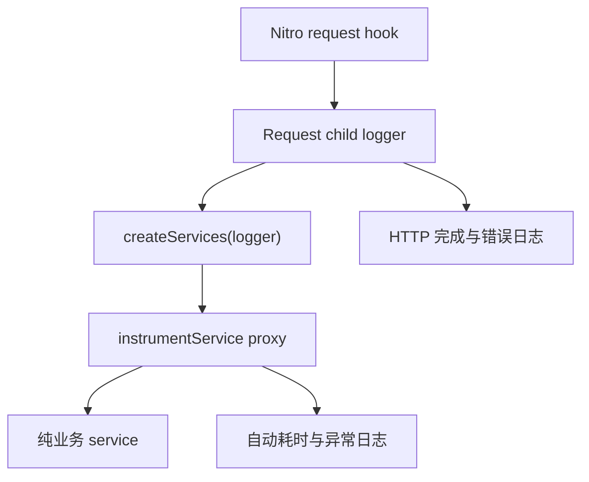

# pnpm Workspace、Nuxt 3 与 Pino Logger 架构讨论

> 生成日期：2026-08-11（Asia/Tokyo）  
> 说明：原始界面未提供逐条消息的精确时间戳，因此以下以消息编号保留完整时间顺序。终端输出中的显示噪声已整理为 Markdown 代码块，但不改变代码语义。

---

## 消息 1 — 用户

我有一个 pnpm workspace 做包管理的，基于 Node.js + Nuxt 3 ESM 的工程。正在实现 portal 模块。计划下一步引进基于 Pino 的 log service。

我不要到处写 `logger.warning……` 之类的函数，希望能提供专业的、反向注入方式的日志实现。

需要我提供给你目前的 `packages/logger` 的代码吗？还是你有能力直接给我代码？或者你还需要我给你一个 apps 包作为 sample？

---

## 消息 2 — 助手

可以直接给你一套实现，但要做到真正适配现有工程，最好提供 `packages/logger` 和一个有代表性的 Nuxt app。否则我只能先假设你们的包导出、构建和依赖注入约定。

建议提供：

- 根目录：`pnpm-workspace.yaml`、根 `package.json`、基础 `tsconfig`
- `packages/logger`：完整目录，尤其是 `package.json`、exports、源码、构建配置和已有测试
- 一个 Nuxt app：
  - `nuxt.config.ts`
  - `plugins/`
  - `server/plugins/`、`server/middleware/`
  - 一个典型的 service/use-case
  - `package.json`
- 如果已有 DI/container、request context、error handler，也一并提供
- `.env` 只给变量名，不要提供密钥

我建议的架构不会让业务代码依赖 Pino，也不需要到处调用全局 `logger.warning(...)`：

```text
业务层 → LoggerPort 接口
             ↑ 注入
Nuxt/Node 组合根 → PinoLoggerAdapter
                       ↓
            request-scoped child logger
```

核心会包括：

- 业务包只依赖 `Logger` 接口，不依赖 `pino`
- 在 Nuxt plugin/server plugin 组合根中反向注入实现
- 通过 `child()` 自动绑定模块、request ID、用户/租户等上下文
- 使用 `AsyncLocalStorage` 传播请求上下文，避免层层传递 logger
- 统一错误序列化、敏感字段脱敏和生产环境输出
- 支持测试用 `NullLogger` / `MemoryLogger`
- ESM、pnpm workspace 和 Nuxt/Nitro 兼容
- 明确区分浏览器端日志与服务端日志，避免把 Pino 服务端实现打进客户端 bundle

所以：**请优先给我 `packages/logger`；再给一个 apps 包作为 sample 会明显降低集成偏差。** 如果 `packages/logger` 目前还是空壳，也可以只给目录结构和配置，我可以直接完成实现。

---

## 消息 3 — 用户

给你代码，几个注意点：

1. 我的 logger 里面的代码可能有错，你尽管修改。
2. 不要在意我的 apps 是否用了 native addon，就限制在 TS 层。如果做不到，也可无视这条。
3. 给我提供代码片段参考时，请提供文件的完整路径名。

### `pnpm-workspace.yaml`

```yaml
packages:
  - "apps/*"
  - "packages/*"
  - "!packages/crypto"

allowBuilds:
  '@prisma/engines': false
  esbuild: false
  prisma: false

catalog:
  # ===== runtime dependencies =====
  "@libsql/client": "0.14.0"
  "@nuxt/ui": "2.21.1"
  "@prisma/adapter-libsql": "7.9.1"
  "@prisma/client": "7.9.1"
  "@t3-oss/env-core": "0.11.1"
  better-auth: "1.6.26"

  # ===== type defination =====
  "@types/node": "22.13.8"
  "@types/pino": "6.3.12"
  "@typescript-eslint/eslint-plugin": "8.26.0"
  "@typescript-eslint/parser": "8.26.0"
  dotenv: "17.4.2"

  # ===== Lint =====
  eslint: "9.21.0"
  "eslint-plugin-vue": "9.32.0"
  magicast: "0.3.5"
  node-addon-api: "8.0.0"
  node-gyp: "10.2.0"

  # ===== Nuxt =====
  nuxt: "3.15.4"
  pino: "9.0.0"

  # ===== database =====
  prisma: "7.9.1"
  server-only: "0.0.1"
  shx: "0.3.4"
  tsx: "4.19.2"
  turbo: "2.5.0"

  # ===== tool-chain =====
  typescript: "5.8.3"
  vue: "3.5.13"
  vue-router: "4.5.0"
  zod: "3.24.2"

strictPeerDependencies: false
```

### 根 `package.json`

```json
{
  "name": "@monorepo/root",
  "version": "1.0.0",
  "private": true,
  "type": "module",
  "packageManager": "pnpm@10.34.4",
  "scripts": {
    "pretest": "tsx scripts/check-esm.ts",
    "build": "turbo run build",
    "lint": "turbo run lint",
    "dev": "turbo run dev",
    "clean": "pnpm -r exec -- rm -rf dist build .turbo .nuxt '*.tsbuildinfo' && rm -rf .turbo",
    "gen": "turbo gen --config ./scripts/generators/config.ts package",
    "db:generate": "pnpm --filter @monorepo/database db:generate",
    "db:push": "pnpm --filter @monorepo/database db:push",
    "db:studio": "pnpm --filter @monorepo/database db:studio"
  },
  "dependencies": {
    "turbo": "catalog:"
  },
  "devDependencies": {
    "@types/node": "catalog:",
    "tsx": "catalog:",
    "typescript": "catalog:"
  },
  "engines": {
    "node": ">=20"
  }
}
```

### 根 `tsconfig.json`

```jsonc
{
  "extends": "@monorepo/tooling/tsconfig/base.json",
  "files": [],
  "compilerOptions": {
    "composite": true,
    "baseUrl": ".",
    "paths": {
      "@monorepo/*": [
        "packages/*/src"
      ],
      "@monorepo/crypto": [
        "packages/crypto/src"
      ],
      "@monorepo/database": [
        "packages/database/src"
      ],
      "@monorepo/logger": [
        "packages/logger/src"
      ],
      "@monorepo/types": [
        "packages/types/src"
      ],
      "@monorepo/tooling/*": [
        "packages/tooling/*"
      ]
    }
  },
  "references": [
    { "path": "packages/types" },
    { "path": "packages/logger" },
    { "path": "packages/database" },
    { "path": "apps/portal" },
    { "path": "packages/ty_demo" }
  ]
}
```

### `packages/tooling/tsconfig/base.json`

```json
{
  "$schema": "https://json.schemastore.org/tsconfig",
  "compilerOptions": {
    "target": "ES2023",
    "module": "NodeNext",
    "moduleResolution": "NodeNext",
    "strict": true,
    "verbatimModuleSyntax": true,
    "isolatedModules": true,
    "noUncheckedIndexedAccess": true,
    "declaration": true,
    "declarationMap": true,
    "sourceMap": true,
    "skipLibCheck": true,
    "forceConsistentCasingInFileNames": true,
    "resolveJsonModule": true
  }
}
```

### `packages/logger/package.json`

```json
{
  "name": "@monorepo/logger",
  "version": "1.0.0",
  "private": true,
  "type": "module",
  "exports": {
    ".": {
      "types": "./dist/index.d.ts",
      "import": "./dist/index.js"
    }
  },
  "main": "./dist/index.js",
  "types": "./dist/index.d.ts",
  "files": [
    "dist/**/*.js",
    "dist/**/*.d.ts"
  ],
  "scripts": {
    "build": "tsc -p tsconfig.json"
  },
  "dependencies": {
    "pino": "catalog:"
  },
  "devDependencies": {
    "@monorepo/config": "workspace:*",
    "@monorepo/types": "workspace:*",
    "@monorepo/tooling": "workspace:*",
    "@types/node": "catalog:",
    "@types/pino": "catalog:",
    "server-only": "catalog:",
    "typescript": "catalog:"
  },
  "allowedDeprecatedVersions": {
    "@types/pino-pretty": "5.0.0",
    "@types/pino-std-serializers": "4.0.0",
    "glob": "7.2.3",
    "inflight": "1.0.6"
  },
  "engines": {
    "pnpm": ">=10.0.0"
  }
}
```

### `packages/logger/tsconfig.json`

```json
{
  "extends": "@monorepo/tooling/tsconfig/base.json",
  "compilerOptions": {
    "outDir": "./dist",
    "rootDir": "./src"
  },
  "include": [
    "src/**/*",
    "index.ts"
  ]
}
```

### `packages/logger/src/index.ts`

```ts
import { pino } from 'pino';

const isDev = process.env.NODE_ENV === 'development';

const options: pino.LoggerOptions = {
  level: isDev ? 'debug' : 'info',
};

if (isDev) {
  options.transport = {
    target: 'pino-pretty',
    options: {
      colorize: true,
      translateTime: 'SYS:yyyy-mm-dd HH:MM:ss.l',
      ignore: 'pid,hostname',
    },
  };
}

export const logger = pino(options);
export default logger;
```

### `apps/ty_demo_app/package.json`

```json
{
  "name": "@monorepo/ty_demo_app",
  "private": true,
  "type": "module",
  "engines": {
    "node": ">=18.0.0",
    "pnpm": ">=10.0.0"
  },
  "scripts": {
    "dev": "nuxt dev",
    "build": "nuxt build",
    "generate": "nuxt generate",
    "preview": "nuxt preview",
    "start": "node .output/server/index.mjs",
    "postinstall": "nuxt prepare",
    "lint": "eslint . --fix",
    "typecheck": "nuxt typecheck"
  },
  "dependencies": {
    "@monorepo/ty_demo": "workspace:*",
    "@monorepo/logger": "workspace:*",
    "vue": "catalog:",
    "vue-router": "catalog:"
  },
  "devDependencies": {
    "@monorepo/config": "workspace:*",
    "@monorepo/types": "workspace:*",
    "@monorepo/tooling": "workspace:*",
    "nuxt": "catalog:",
    "@nuxt/ui": "catalog:",
    "magicast": "catalog:"
  }
}
```

### `apps/ty_demo_app/tsconfig.json`

```json
{
  "extends": "@monorepo/tooling/tsconfig/base.json",
  "compilerOptions": {
    "types": ["node", "nitropack"]
  },
  "include": [
    "**/*.ts",
    "**/*.tsx",
    "**/*.vue"
  ],
  "exclude": [
    "node_modules",
    ".nuxt",
    ".output",
    "dist"
  ]
}
```

### `apps/ty_demo_app/nuxt.config.ts`

```ts
import { defineNuxtConfig } from 'nuxt/config'

export default defineNuxtConfig({
  compatibilityDate: '2025-01-15',
  devtools: { enabled: false },
  devServer: { port: 10002 },
  modules: ['@nuxt/ui'],
  vite: {
    server: {
      fs: {
        allow: ['../..', '/workspace/monorepo']
      }
    }
  }
})
```

### `apps/ty_demo_app/server/api/ty_demo.ts`

```ts
import { getWholeSentence } from '../services/native-binding.js'
import type { ApiResponse } from '@monorepo/types'

export default defineEventHandler(async () => {
  try {
    const data = getWholeSentence('chenty-apps')
    return `${data}`
  } catch (error) {
    console.error('Error details:', error)
    return {
      success: false,
      data: error.message || 'Unknown error'
    }
  }
})
```

### `apps/ty_demo_app/server/services/native-binding.ts`

```ts
import { ty_demo } from '@monorepo/ty_demo'

export function getWholeSentence(name?: string): string {
  // logger.debug(`getWholeSentence called with name=${name}`)
  const result = ty_demo.getWholeSentence(name)
  // logger.debug(`getWholeSentence returned: ${result}`)
  return result
}
```

---

## 消息 4 — 助手

可以按现有结构直接改。推荐采用：

- `@monorepo/logger` 只暴露 Logger 接口和自动 instrumentation。
- `@monorepo/logger/pino` 才暴露 Pino adapter。
- Nuxt `server/plugins` 是组合根，创建 logger、request child logger 和 services。
- 业务 service 不导入 logger，也不写 `logger.warn()`。
- 通过 Proxy 在 service 边界自动记录调用成功、耗时和异常。
- HTTP 请求日志由 Nitro 生命周期自动完成。Nitro 官方支持在 server plugin 中监听请求、响应和错误生命周期；Pino child logger 适合绑定 request ID 等固定上下文。

下面将你终端里的工程根目录推断为 `/Users/chent/Downloads/test_demo`。

### 1. Logger 接口

`/Users/chent/Downloads/test_demo/packages/logger/src/types.ts`

```ts
export type LogLevel =
  | 'trace'
  | 'debug'
  | 'info'
  | 'warn'
  | 'error'
  | 'fatal'

export type LoggerLevel = LogLevel | 'silent'

export type LogFields = Readonly<Record<string, unknown>>

export type LogInput = string | LogFields

export interface Logger {
  child(bindings: LogFields): Logger
  isLevelEnabled(level: LogLevel): boolean
  trace(input: LogInput, message?: string): void
  debug(input: LogInput, message?: string): void
  info(input: LogInput, message?: string): void
  warn(input: LogInput, message?: string): void
  error(input: LogInput, message?: string): void
  fatal(input: LogInput, message?: string): void
}
```

业务 package 只需要依赖这个接口，不需要知道 Pino 的存在。

### 2. Pino adapter

`/Users/chent/Downloads/test_demo/packages/logger/src/pino.ts`

```ts
import {
  pino,
  type Logger as PinoLogger,
  type LoggerOptions,
} from 'pino'

import type {
  Logger,
  LoggerLevel,
  LogFields,
  LogInput,
  LogLevel,
} from './types.js'

const DEFAULT_REDACT_PATHS = [
  'password',
  'token',
  'accessToken',
  'refreshToken',
  'authorization',
  'cookie',
  'headers.authorization',
  'headers.cookie',
  'req.headers.authorization',
  'req.headers.cookie',
] as const

export interface PinoLoggerOptions {
  service: string
  level?: LoggerLevel
  pretty?: boolean
  base?: LogFields
  redactPaths?: readonly string[]
}

type NativeLogMethod = (
  input: unknown,
  message?: string,
) => void

function write(
  nativeLogger: PinoLogger,
  level: LogLevel,
  input: LogInput,
  message?: string,
): void {
  const method = nativeLogger[level].bind(
    nativeLogger,
  ) as NativeLogMethod

  if (typeof input === 'string') {
    method(input)
    return
  }

  if (message === undefined) {
    method(input)
    return
  }

  method(input, message)
}

function adapt(nativeLogger: PinoLogger): Logger {
  return {
    child(bindings) {
      return adapt(nativeLogger.child({ ...bindings }))
    },
    isLevelEnabled(level) {
      return nativeLogger.isLevelEnabled(level)
    },
    trace(input, message) {
      write(nativeLogger, 'trace', input, message)
    },
    debug(input, message) {
      write(nativeLogger, 'debug', input, message)
    },
    info(input, message) {
      write(nativeLogger, 'info', input, message)
    },
    warn(input, message) {
      write(nativeLogger, 'warn', input, message)
    },
    error(input, message) {
      write(nativeLogger, 'error', input, message)
    },
    fatal(input, message) {
      write(nativeLogger, 'fatal', input, message)
    },
  }
}

export function createPinoLogger(
  config: PinoLoggerOptions,
): Logger {
  const options: LoggerOptions = {
    level: config.level ?? 'info',
    base: {
      service: config.service,
      ...config.base,
    },
    timestamp: pino.stdTimeFunctions.isoTime,
    serializers: {
      err: pino.stdSerializers.err,
      error: pino.stdSerializers.err,
    },
    redact: {
      paths: [
        ...(config.redactPaths ?? DEFAULT_REDACT_PATHS),
      ],
      censor: '[REDACTED]',
    },
    ...(config.pretty
      ? {
          transport: {
            target: 'pino-pretty',
            options: {
              colorize: true,
              translateTime: 'SYS:standard',
              ignore: 'pid,hostname',
            },
          },
        }
      : {}),
  }

  return adapt(pino(options))
}
```

Pino 官方建议生产环境输出 NDJSON，把 pretty formatting 放在 transport 中；transport 在独立 worker 中处理。

### 3. 自动包装 service

`/Users/chent/Downloads/test_demo/packages/logger/src/instrument-service.ts`

```ts
import type {
  Logger,
  LogLevel,
} from './types.js'

type SuccessLogLevel = Extract<
  LogLevel,
  'trace' | 'debug' | 'info'
>

export interface InstrumentServiceOptions {
  component: string
  logSuccess?: boolean
  successLevel?: SuccessLogLevel
  include?: readonly PropertyKey[]
}

function elapsedMilliseconds(startedAt: number): number {
  return Math.round(
    (performance.now() - startedAt) * 100,
  ) / 100
}

function isPromiseLike(
  value: unknown,
): value is PromiseLike<unknown> {
  return (
    (typeof value === 'object' ||
      typeof value === 'function') &&
    value !== null &&
    'then' in value &&
    typeof value.then === 'function'
  )
}

/**
 * 在组合根中包装 service。
 *
 * 不记录方法参数和返回值，避免密码、token、用户数据
 * 被意外写入日志。
 */
export function instrumentService<T extends object>(
  service: T,
  parentLogger: Logger,
  options: InstrumentServiceOptions,
): T {
  const logger = parentLogger.child({
    component: options.component,
  })

  const logSuccess = options.logSuccess ?? true
  const successLevel = options.successLevel ?? 'debug'

  const includedMethods = options.include
    ? new Set<PropertyKey>(options.include)
    : undefined

  const methodCache = new Map<PropertyKey, unknown>()

  return new Proxy(service, {
    get(target, property) {
      const original = Reflect.get(target, property, target)

      if (typeof original !== 'function') {
        return original
      }

      if (
        includedMethods !== undefined &&
        !includedMethods.has(property)
      ) {
        return original.bind(target)
      }

      const cached = methodCache.get(property)

      if (cached !== undefined) {
        return cached
      }

      const operation = String(property)

      const wrapped = (...args: unknown[]): unknown => {
        const startedAt = performance.now()

        const logCompleted = (): void => {
          if (!logSuccess) {
            return
          }

          logger[successLevel](
            {
              event: 'service.operation.completed',
              operation,
              durationMs: elapsedMilliseconds(startedAt),
            },
            `${options.component}.${operation} completed`,
          )
        }

        const logFailed = (error: unknown): void => {
          logger.error(
            {
              event: 'service.operation.failed',
              operation,
              durationMs: elapsedMilliseconds(startedAt),
              err: error,
            },
            `${options.component}.${operation} failed`,
          )
        }

        try {
          const result = Reflect.apply(
            original,
            target,
            args,
          ) as unknown

          if (isPromiseLike(result)) {
            return Promise.resolve(result).then(
              (value) => {
                logCompleted()
                return value
              },
              (error: unknown) => {
                logFailed(error)
                throw error
              },
            )
          }

          logCompleted()
          return result
        } catch (error: unknown) {
          logFailed(error)
          throw error
        }
      }

      methodCache.set(property, wrapped)
      return wrapped
    },
  })
}
```

默认不记录参数和返回值。这一点很重要：自动记录参数看起来方便，但极容易把密码、token、身份证号等写入日志。

### 4. 测试用空 Logger

`/Users/chent/Downloads/test_demo/packages/logger/src/noop.ts`

```ts
import type { Logger } from './types.js'

const noopLogger: Logger = {
  child: () => noopLogger,
  isLevelEnabled: () => false,
  trace: () => undefined,
  debug: () => undefined,
  info: () => undefined,
  warn: () => undefined,
  error: () => undefined,
  fatal: () => undefined,
}

export function createNoopLogger(): Logger {
  return noopLogger
}
```

service 单元测试可以传 `createNoopLogger()`，不需要 mock Pino。

### 5. Logger package 入口

`/Users/chent/Downloads/test_demo/packages/logger/src/index.ts`

```ts
export {
  instrumentService,
  type InstrumentServiceOptions,
} from './instrument-service.js'

export { createNoopLogger } from './noop.js'

export type {
  Logger,
  LoggerLevel,
  LogFields,
  LogInput,
  LogLevel,
} from './types.js'
```

注意这里不导出 Pino adapter，避免普通业务 import 意外把 Pino 拉进客户端 bundle。

### 6. Logger package 配置

`/Users/chent/Downloads/test_demo/packages/logger/package.json`

```json
{
  "name": "@monorepo/logger",
  "version": "1.0.0",
  "private": true,
  "type": "module",
  "sideEffects": false,
  "exports": {
    ".": {
      "types": "./dist/index.d.ts",
      "import": "./dist/index.js"
    },
    "./pino": {
      "types": "./dist/pino.d.ts",
      "import": "./dist/pino.js"
    }
  },
  "main": "./dist/index.js",
  "types": "./dist/index.d.ts",
  "files": [
    "dist"
  ],
  "scripts": {
    "build": "tsc -p tsconfig.json"
  },
  "dependencies": {
    "pino": "catalog:",
    "pino-pretty": "catalog:"
  },
  "devDependencies": {
    "@monorepo/tooling": "workspace:*",
    "@types/node": "catalog:",
    "typescript": "catalog:"
  },
  "engines": {
    "node": ">=20",
    "pnpm": ">=10"
  }
}
```

删除以下依赖：

- `@types/pino`：Pino 已自带类型。
- `server-only`：它并不是通用的 Nuxt server-only 标记。
- 当前 logger 没使用的 `@monorepo/config`、`@monorepo/types`。

`/Users/chent/Downloads/test_demo/packages/logger/tsconfig.json`

```json
{
  "extends": "@monorepo/tooling/tsconfig/base.json",
  "compilerOptions": {
    "outDir": "./dist",
    "rootDir": "./src"
  },
  "include": [
    "src/**/*.ts"
  ]
}
```

在 `/Users/chent/Downloads/test_demo/pnpm-workspace.yaml` 的 `catalog` 中添加：

```yaml
pino-pretty: "13.1.3"
```

### 7. Nuxt service 组合根

这是“反向注入”实际发生的位置。

`/Users/chent/Downloads/test_demo/apps/ty_demo_app/server/factories/services.ts`

```ts
import {
  instrumentService,
  type Logger,
} from '@monorepo/logger'

import {
  getWholeSentence,
} from '../services/native-binding.js'

const nativeBindingImplementation = {
  getWholeSentence,
}

export function createServices(logger: Logger) {
  return {
    nativeBinding: instrumentService(
      nativeBindingImplementation,
      logger,
      {
        component: 'native-binding',
        successLevel: 'debug',
      },
    ),
  }
}

export type Services = ReturnType<typeof createServices>
```

此后 `native-binding.ts` 不需要知道 logger 存在。

`/Users/chent/Downloads/test_demo/apps/ty_demo_app/server/services/native-binding.ts`

```ts
import { ty_demo } from '@monorepo/ty_demo'

export function getWholeSentence(
  name?: string,
): string {
  return ty_demo.getWholeSentence(name)
}
```

### 8. 扩展 H3 request context

`/Users/chent/Downloads/test_demo/apps/ty_demo_app/server/types/h3.d.ts`

```ts
import type { Logger } from '@monorepo/logger'
import type {
  Services,
} from '../factories/services.js'

declare module 'h3' {
  interface H3EventContext {
    logger: Logger
    services: Services
    requestId: string
    requestStartedAt: number
  }
}

export {}
```

### 9. Nitro 自动请求日志插件

`/Users/chent/Downloads/test_demo/apps/ty_demo_app/server/plugins/01.logging.ts`

```ts
import { randomUUID } from 'node:crypto'

import {
  getHeader,
  getRequestURL,
  setHeader,
} from 'h3'

import type {
  LoggerLevel,
} from '@monorepo/logger'

import {
  createPinoLogger,
} from '@monorepo/logger/pino'

import {
  createServices,
} from '../factories/services.js'

const VALID_LOG_LEVELS = new Set<LoggerLevel>([
  'trace',
  'debug',
  'info',
  'warn',
  'error',
  'fatal',
  'silent',
])

function normalizeLogLevel(
  value: unknown,
): LoggerLevel {
  if (
    typeof value === 'string' &&
    VALID_LOG_LEVELS.has(value as LoggerLevel)
  ) {
    return value as LoggerLevel
  }

  return 'info'
}

function normalizeRequestId(
  value: string | undefined,
): string {
  if (
    value !== undefined &&
    /^[A-Za-z0-9_-]{1,100}$/.test(value)
  ) {
    return value
  }

  return randomUUID()
}

export default defineNitroPlugin((nitroApp) => {
  const runtimeConfig = useRuntimeConfig()

  const rootLogger = createPinoLogger({
    service: 'ty-demo-app',
    level: normalizeLogLevel(runtimeConfig.logLevel),
    pretty: import.meta.dev,
  })

  nitroApp.hooks.hook('request', (event) => {
    const requestId = normalizeRequestId(
      getHeader(event, 'x-request-id'),
    )

    const url = getRequestURL(event)

    event.context.requestId = requestId
    event.context.requestStartedAt = performance.now()

    event.context.logger = rootLogger.child({
      requestId,
      method: event.node.req.method,
      path: url.pathname,
    })

    event.context.services = createServices(
      event.context.logger,
    )

    setHeader(event, 'x-request-id', requestId)

    event.context.logger.info(
      {
        event: 'http.request.started',
      },
      'request started',
    )
  })

  nitroApp.hooks.hook('afterResponse', (event) => {
    const logger = event.context.logger

    const durationMs = Math.round(
      (
        performance.now() -
        event.context.requestStartedAt
      ) * 100,
    ) / 100

    const fields = {
      event: 'http.request.completed',
      statusCode: event.node.res.statusCode,
      durationMs,
    }

    if (event.node.res.statusCode >= 500) {
      logger.error(fields, 'request completed')
    } else if (event.node.res.statusCode >= 400) {
      logger.warn(fields, 'request completed')
    } else {
      logger.info(fields, 'request completed')
    }
  })

  nitroApp.hooks.hook(
    'error',
    (error, context) => {
      const logger =
        context.event?.context.logger ?? rootLogger

      logger.error(
        {
          event: 'http.request.error',
          err: error,
          tags: context.tags,
        },
        'request failed',
      )
    },
  )
})
```

这里 child logger 的字段名全部由应用控制，没有把任意用户对象直接传给 `child()`；这符合 Pino 对 child bindings 的安全建议。

### 10. API route 不再写日志

`/Users/chent/Downloads/test_demo/apps/ty_demo_app/server/api/ty_demo.ts`

```ts
export default defineEventHandler((event) => {
  return event.context.services
    .nativeBinding
    .getWholeSentence('chenty-apps')
})
```

原来的 `try/catch` 应当删除，因为它有两个问题：

- `error` 在 strict TypeScript 下是 `unknown`，不能直接读取 `error.message`。
- 捕获异常后返回普通对象，会让请求变成 HTTP 200，Nitro 全局错误日志也无法正确识别失败。

需要业务化错误响应时，应抛出 `createError()`，而不是吞掉异常。

### 11. Nuxt 配置

`/Users/chent/Downloads/test_demo/apps/ty_demo_app/nuxt.config.ts`

```ts
import { defineNuxtConfig } from 'nuxt/config'

export default defineNuxtConfig({
  compatibilityDate: '2025-01-15',
  devtools: {
    enabled: false,
  },
  devServer: {
    port: 10002,
  },
  modules: [
    '@nuxt/ui',
  ],
  runtimeConfig: {
    logLevel:
      process.env.LOG_LEVEL ??
      (
        process.env.NODE_ENV === 'development'
          ? 'debug'
          : 'info'
      ),
  },
  nitro: {
    externals: {
      external: [
        'pino',
        'pino-pretty',
      ],
    },
  },
  vite: {
    server: {
      fs: {
        allow: [
          '../..',
          '/workspace/monorepo',
        ],
      },
    },
  },
})
```

把 Pino 和 `pino-pretty` externalize 可以减少 Nitro bundling 对 Pino worker transport 文件解析的干扰。

最终调用关系：



验证命令：

```bash
pnpm install
pnpm --filter @monorepo/logger build
pnpm --filter @monorepo/ty_demo_app typecheck
pnpm --filter @monorepo/ty_demo_app dev
```

这套方案能消除 HTTP handler 和 service 中绝大多数日志调用。只有“用户完成支付”“权限被管理员撤销”一类有明确业务语义的事件仍应显式产生 domain/audit event；通过 Proxy 自动猜测这类业务语义并不可靠。

另外，当前使用的 Nuxt `3.15.4` 已经比较旧；日志改造不要求立即升级，但建议把 Nuxt/Nitro 升级单独列为后续工作，不能和本次改造混在同一个提交里。

---

## 消息 5 — 用户

我有一个 types 的包，你有什么融合方案吗？给你看看 types 包现在的样子：

### `packages/types/package.json`

```json
{
  "name": "@monorepo/types",
  "version": "0.0.1",
  "private": true,
  "type": "module",
  "main": "./src/index.ts",
  "types": "./src/index.ts",
  "exports": {
    ".": {
      "types": "./src/index.ts",
      "import": "./src/index.ts"
    }
  },
  "dependencies": {
    "zod": "catalog:"
  }
}
```

### `packages/types/tsconfig.json`

```json
{
  "extends": "@monorepo/tooling/tsconfig/base.json",
  "compilerOptions": {
    "rootDir": "./src",
    "outDir": "./dist"
  },
  "include": [
    "src/**/*"
  ]
}
```

### `packages/types/src/index.ts`

```ts
import { z } from 'zod';

// Login table Schema
export const LoginInputSchema = z.object({
  email: z.string().email("必须是合法的邮箱地址"),
  password: z.string().min(8, "密码不能少于 8 位")
});

export type LoginInput = z.infer<typeof LoginInputSchema>;

// build mode env variable enum
export const AppEnvironmentSchema = z.enum([
  'development',
  'production',
  'test'
]);

export type AppEnvironment = z.infer<typeof AppEnvironmentSchema>;
```

---

## 消息 6 — 助手

有融合方案，但最合适的是在 Nuxt 组合根融合，而不是把 `Logger` 接口塞进 `@monorepo/types`。

推荐依赖关系：

```text
apps/portal ───────→ @monorepo/types
     │
     └─────────────→ @monorepo/logger ─→ pino

业务 service 不依赖 logger
@monorepo/types 与 @monorepo/logger 互不依赖
```

这样可以避免 `types` 最终变成什么都放的公共垃圾箱，也避免 `logger → types → 其他业务类型` 的依赖扩散。

### 包职责

| 包 | 应该包含 | 不建议包含 |
|---|---|---|
| `@monorepo/types` | API DTO、Zod schema、环境枚举、跨包数据契约 | Logger、数据库实体、service 接口 |
| `@monorepo/logger` | Logger port、Pino adapter、日志 instrumentation | Login DTO、业务 Schema |
| `apps/*` | 校验配置并组装 logger/services | Pino 具体实现散落在业务代码 |

严格来说，你的包同时导出了 Zod runtime value，所以它并不是纯 `types` 包，更接近 `contracts`。现在不必改名，但长期可以考虑 `@monorepo/contracts`。

### 先修正 types 包的构建方式

现在 `exports.import` 指向 `src/index.ts`，Node 20 不能正常把它当普通 ESM JavaScript 包执行；而且它声明了 `dist`，却没有 build script。

`/Users/chent/Downloads/test_demo/packages/types/package.json`

```json
{
  "name": "@monorepo/types",
  "version": "0.0.1",
  "private": true,
  "type": "module",
  "sideEffects": false,
  "main": "./dist/index.js",
  "types": "./dist/index.d.ts",
  "exports": {
    ".": {
      "types": "./dist/index.d.ts",
      "import": "./dist/index.js"
    }
  },
  "files": [
    "dist"
  ],
  "scripts": {
    "build": "tsc -p tsconfig.json"
  },
  "dependencies": {
    "zod": "catalog:"
  },
  "devDependencies": {
    "@monorepo/tooling": "workspace:*",
    "typescript": "catalog:"
  },
  "engines": {
    "node": ">=20",
    "pnpm": ">=10"
  }
}
```

`/Users/chent/Downloads/test_demo/packages/types/tsconfig.json`

```json
{
  "extends": "@monorepo/tooling/tsconfig/base.json",
  "compilerOptions": {
    "rootDir": "./src",
    "outDir": "./dist"
  },
  "include": [
    "src/**/*.ts"
  ]
}
```

### 建议拆分 types 源码

`/Users/chent/Downloads/test_demo/packages/types/src/auth/login.ts`

```ts
import { z } from 'zod'

export const LoginInputSchema = z.object({
  email: z
    .string()
    .email('必须是合法的邮箱地址'),

  password: z
    .string()
    .min(8, '密码不能少于 8 位'),
})

export type LoginInput = z.infer<
  typeof LoginInputSchema
>
```

`/Users/chent/Downloads/test_demo/packages/types/src/environment.ts`

```ts
import { z } from 'zod'

export const AppEnvironmentSchema = z.enum([
  'development',
  'production',
  'test',
])

export type AppEnvironment = z.infer<
  typeof AppEnvironmentSchema
>
```

`/Users/chent/Downloads/test_demo/packages/types/src/index.ts`

```ts
export {
  LoginInputSchema,
  type LoginInput,
} from './auth/login.js'

export {
  AppEnvironmentSchema,
  type AppEnvironment,
} from './environment.js'
```

NodeNext 下，源码中的相对 import/export 应写 `.js`，即使实际文件是 `.ts`。

### 在 Nuxt 组合根中融合

`AppEnvironmentSchema` 可以负责验证运行环境，然后把验证后的环境作为固定字段注入 Pino。

建议给 logger 增加统一的日志级别解析，避免每个 app 重复写校验逻辑。

`/Users/chent/Downloads/test_demo/packages/logger/src/levels.ts`

```ts
import type {
  LoggerLevel,
} from './types.js'

export const LOGGER_LEVELS = [
  'trace',
  'debug',
  'info',
  'warn',
  'error',
  'fatal',
  'silent',
] as const satisfies readonly LoggerLevel[]

const loggerLevelSet = new Set<string>(
  LOGGER_LEVELS,
)

export function isLoggerLevel(
  value: unknown,
): value is LoggerLevel {
  return (
    typeof value === 'string' &&
    loggerLevelSet.has(value)
  )
}

export function parseLoggerLevel(
  value: unknown,
  fallback: LoggerLevel = 'info',
): LoggerLevel {
  return isLoggerLevel(value)
    ? value
    : fallback
}
```

`/Users/chent/Downloads/test_demo/packages/logger/src/index.ts`

在原有 exports 基础上增加：

```ts
export {
  LOGGER_LEVELS,
  isLoggerLevel,
  parseLoggerLevel,
} from './levels.js'
```

然后修改 Nuxt logging plugin。

`/Users/chent/Downloads/test_demo/apps/ty_demo_app/server/plugins/01.logging.ts`

```ts
import { randomUUID } from 'node:crypto'

import {
  getHeader,
  getRequestURL,
  setHeader,
} from 'h3'

import {
  parseLoggerLevel,
} from '@monorepo/logger'

import {
  createPinoLogger,
} from '@monorepo/logger/pino'

import {
  AppEnvironmentSchema,
} from '@monorepo/types'

import {
  createServices,
} from '../factories/services.js'

function getEnvironment() {
  const result = AppEnvironmentSchema.safeParse(
    process.env.NODE_ENV,
  )

  return result.success
    ? result.data
    : 'production'
}

function normalizeRequestId(
  value: string | undefined,
): string {
  if (
    value !== undefined &&
    /^[A-Za-z0-9_-]{1,100}$/.test(value)
  ) {
    return value
  }

  return randomUUID()
}

export default defineNitroPlugin((nitroApp) => {
  const runtimeConfig = useRuntimeConfig()
  const environment = getEnvironment()

  const rootLogger = createPinoLogger({
    service: 'ty-demo-app',
    level: parseLoggerLevel(
      runtimeConfig.logLevel,
      environment === 'development'
        ? 'debug'
        : 'info',
    ),
    pretty: environment === 'development',
    base: {
      environment,
      application: 'ty_demo_app',
    },
  })

  nitroApp.hooks.hook('request', (event) => {
    const requestId = normalizeRequestId(
      getHeader(event, 'x-request-id'),
    )

    const url = getRequestURL(event)

    event.context.requestId = requestId
    event.context.requestStartedAt = performance.now()

    event.context.logger = rootLogger.child({
      requestId,
      method: event.node.req.method,
      path: url.pathname,
    })

    event.context.services = createServices(
      event.context.logger,
    )

    setHeader(event, 'x-request-id', requestId)

    event.context.logger.info(
      {
        event: 'http.request.started',
      },
      'request started',
    )
  })

  nitroApp.hooks.hook('afterResponse', (event) => {
    const durationMs = Math.round(
      (
        performance.now() -
        event.context.requestStartedAt
      ) * 100,
    ) / 100

    const fields = {
      event: 'http.request.completed',
      statusCode: event.node.res.statusCode,
      durationMs,
    }

    if (event.node.res.statusCode >= 500) {
      event.context.logger.error(
        fields,
        'request completed',
      )
    } else if (event.node.res.statusCode >= 400) {
      event.context.logger.warn(
        fields,
        'request completed',
      )
    } else {
      event.context.logger.info(
        fields,
        'request completed',
      )
    }
  })

  nitroApp.hooks.hook(
    'error',
    (error, context) => {
      const logger =
        context.event?.context.logger ?? rootLogger

      logger.error(
        {
          event: 'http.request.error',
          err: error,
          tags: context.tags,
        },
        'request failed',
      )
    },
  )
})
```

这里就是两个包的融合点：

- `@monorepo/types` 校验外部输入和环境。
- `@monorepo/logger` 负责日志能力。
- Nuxt app 决定怎样把经过校验的数据注入 logger。

### 不建议放进 types 包的内容

不建议这样做：

```ts
// packages/types/src/logger.ts
export interface Logger {
  info(...): void
  error(...): void
}
```

因为 `Logger` 是 logging capability 的契约，应该由 `@monorepo/logger` 自己拥有。

也不建议用 Zod 校验每一条日志：

```ts
LogRecordSchema.parse(fields)
```

日志通常位于高频路径；每次 Zod parse 会产生额外开销，而且 `Error`、Request 等对象未必是 JSON 数据。应该只在配置/API 边界使用 Zod，日志内部依赖 TypeScript 类型、Pino serializer 和 redaction。

只有一种例外：如果未来要把结构化事件投递到 Kafka、消息队列或审计库，那么这种跨进程协议可以放进 `@monorepo/types`：

```ts
export const UserLoggedInEventSchema = z.object({
  eventId: z.string().uuid(),
  userId: z.string(),
  occurredAt: z.string().datetime(),
})
```

但它是 domain event，不是普通 debug/info 日志。

---

## 消息 7 — 用户

请把本次对话整理成 Markdown 文件，保留用户和助手角色、代码块及时间顺序，生成文件供我下载。

